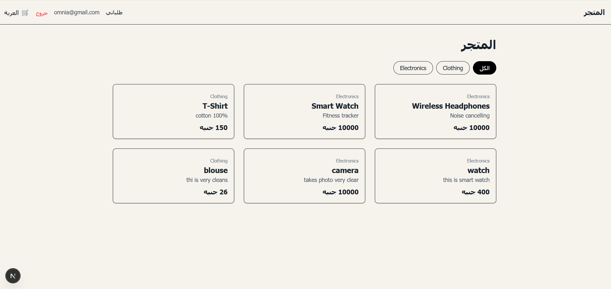
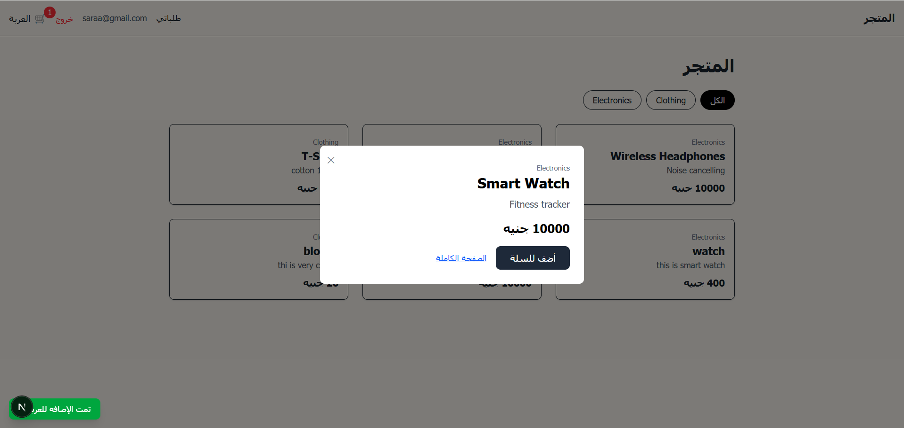
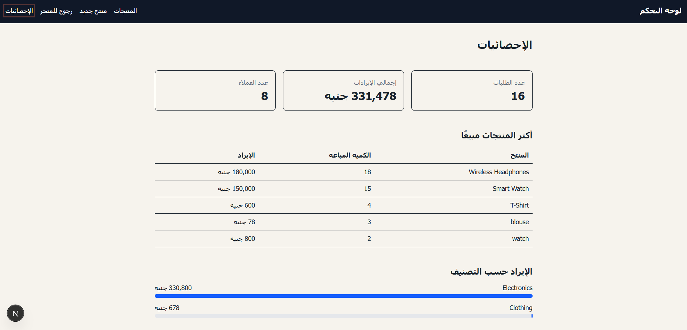

# Graph Commerce

A full-stack e-commerce app built with **Next.js 16**, **TypeScript** and a **graph database** (CognoDB, queried with Cypher over Bolt). Products, categories, carts and orders are modeled as nodes and relationships, so features like related products and sales analytics are simple graph traversals.



## Features

- **Catalog:** category filters driven by the URL, product details, related products from graph relationships, and a quick-view modal (parallel + intercepting routes).
- **Cart and checkout:** per-user cart stored in the database, optimistic updates with React Query, toast notifications with Zustand, and an atomic, idempotent checkout that creates the order and snapshots unit prices.
- **Authentication:** signup, login and logout with bcrypt-hashed passwords and a signed JWT in an httpOnly cookie. Private routes are protected in `proxy.ts`.
- **Admin dashboard:** role-based authorization (the role is read from the database, not from the token) to add, edit and hide products with idempotent writes and optimistic locking, plus sales analytics (totals, top products, revenue by category).
- **Performance:** Next.js Cache Components (`use cache`, `cacheTag`, `updateTag`), Suspense streaming, and loading, error and not-found boundaries.

<p>
  
  
</p>

## Tech stack

| Layer | Tools |
|---|---|
| Framework | Next.js 16 (App Router), React, TypeScript |
| Styling | Tailwind CSS (RTL Arabic UI) |
| Database | CognoDB (graph) via `neo4j-driver`, Cypher |
| Auth | `bcryptjs`, `jsonwebtoken`, `jose`, httpOnly cookies |
| State | TanStack React Query (server state), Zustand (UI state) |
| Mutations | Server Actions for forms, Route Handlers for cart and checkout |

## Graph model

```text
(Customer)-[:HAS_IN_CART {quantity}]->(Product)
(Customer)-[:PLACED]->(Order)-[:CONTAINS {quantity, unitPrice}]->(Product)
(Product)-[:BELONGS_TO]->(Category)
(Product)-[:RELATED_TO]->(Product)
```

## Getting started

**Prerequisites:** Node.js 20.9 or newer and a CognoDB instance (developed against CognoDB; the driver is Neo4j-compatible).

1. Install dependencies:

   ```bash
   git clone https://github.com/omniafathy1/graph-commerce.git
   cd graph-commerce
   npm install
   ```

2. Copy `.env.example` to `.env.local` and fill in your values:

   | Variable | Description |
   |---|---|
   | `COGNO_URI` | Bolt connection URI of your instance |
   | `COGNO_USERNAME` / `COGNO_PASSWORD` | Database credentials |
   | `JWT_SECRET` | Long random string, e.g. `node -e "console.log(require('crypto').randomBytes(32).toString('hex'))"` |

3. Create the initial data. Run each statement separately in your database console:

   ```cypher
   CREATE CONSTRAINT customer_email_unique IF NOT EXISTS
   FOR (c:Customer) REQUIRE c.email IS UNIQUE
   ```

   ```cypher
   CREATE CONSTRAINT order_idempotency_unique IF NOT EXISTS
   FOR (o:Order) REQUIRE o.idempotencyKey IS UNIQUE
   ```

   ```cypher
   CREATE CONSTRAINT product_idempotency_unique IF NOT EXISTS
   FOR (p:Product) REQUIRE p.idempotencyKey IS UNIQUE
   ```

   ```cypher
   CREATE (:Category {name: 'Electronics'}), (:Category {name: 'Clothing'})
   ```

4. Start the app with `npm run dev` and open http://localhost:3000.

5. Sign up in the app, then make yourself an admin:

   ```cypher
   MATCH (c:Customer {email: 'you@example.com'}) SET c.role = 'admin'
   ```

   Add products from `/admin/new`. To link related products:

   ```cypher
   MATCH (a:Product {name: 'Product A'}), (b:Product {name: 'Product B'})
   CREATE (a)-[:RELATED_TO]->(b), (b)-[:RELATED_TO]->(a)
   ```

## Scripts

| Command | Description |
|---|---|
| `npm run dev` | Start the development server |
| `npm run build` | Production build |
| `npm start` | Run the production build |
| `npm run lint` | Lint the code |

## Design decisions

- **Soft delete:** products are hidden with an `active` flag instead of being deleted, so past orders stay intact.
- **Price snapshot:** `unitPrice` is stored on each order line, so changing a product price never changes historical totals.
- **Role from the database:** revoking admin access takes effect immediately instead of waiting for a token to expire.
- **Authorization in every Server Action:** actions are public endpoints, so each one checks the role itself and the proxy is only a coarse gate.
- **Server state vs UI state:** React Query owns data from the server, Zustand owns UI-only state such as toasts.
- **Atomic checkout:** creating the order and emptying the cart run in one transaction, so a failure never leaves an order behind with a full cart.
- **Idempotent writes:** checkout and product creation carry a client-generated idempotency key backed by a unique constraint, so retries and double submits return the existing record instead of creating a duplicate.
- **Intent-based admin actions:** hiding or showing a product sends the desired state instead of flipping the current one, so double clicks and stale pages cannot undo each other.
- **Optimistic locking:** products carry a `version` that the edit form sends back; the update only applies when it still matches, so two admins cannot silently overwrite each other's changes.

## Known limitations and next steps

- No stock management, payments or order status flow.
- No rate limiting on login and no automated tests yet.
- `elementId()` is used in URLs; a UUID property would be more stable.
- Categories and related products are managed with Cypher, not from the UI.
- Checkouts from two different tabs use different keys; a per-customer lock would close that gap.