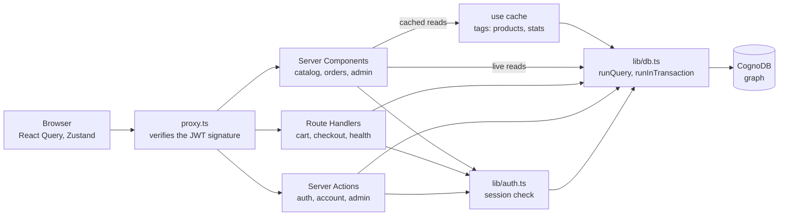
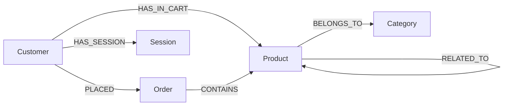

# Architecture

How Graph Commerce is organized and why. Each decision record states the context, the choice, what was rejected and the cost that came with it.

## System overview

## Data model

## Decision records

1. [Use a graph database](#adr-001-use-a-graph-database)
2. [Server-side sessions instead of a long-lived stateless JWT](#adr-002-server-side-sessions-instead-of-a-long-lived-stateless-jwt)
3. [Cache Components and what they cost](#adr-003-cache-components-and-what-they-cost)
4. [Transactions, idempotency and conditional writes](#adr-004-transactions-idempotency-and-conditional-writes)
5. [End-to-end tests on a real database, CI without secrets](#adr-005-end-to-end-tests-on-a-real-database-ci-without-secrets)

---

## ADR-001: Use a graph database

**Status:** Accepted

**Context.** The domain is relationship-heavy: related products, per-customer carts and orders, and sales analytics that follow customer, order, product and category.

**Decision.** Model it as a graph in CognoDB, accessed with `neo4j-driver` over Bolt and queried with Cypher.

**Alternatives considered.**
- PostgreSQL: mature tooling, ORMs and migrations.
- MongoDB: products fit documents, but order analytics need lookups across collections.

**Consequences.**
- (+) Related products, top sellers and revenue per category are short traversals instead of multi-table joins.
- (+) Uniqueness rules (email, idempotency keys, session ids) are constraints on nodes.
- (-) No ORM or migration tool: queries are handwritten and constraints are created manually (documented in the README).
- (-) CognoDB speaks Bolt and Cypher but is not fully Neo4j-compatible. `epochMillis` is unsupported, so timestamps are stored as numbers from `timestamp()`, and `PROFILE` returns no plan details, so slow queries are logged by the application instead.
- (-) For a catalog this size a relational database would also have worked. The graph was chosen for fit and to learn it, not out of necessity.

## ADR-002: Server-side sessions instead of a long-lived stateless JWT

**Status:** Accepted

**Context.** A signed JWT is valid until it expires. The first design used a 7-day token, so a copied token could not be revoked and logout only deleted the cookie.

**Decision.** Every login creates a `Session` node linked from the customer, and the JWT carries its id (`sid`). `getCurrentUser` verifies the signature, then checks that the session exists and has not expired, once per request (`React.cache`). Logout deletes the session. An account page lists a customer's sessions and ends them, and ending one by id is scoped to the signed-in customer to prevent IDOR. The admin role is read from the database, never from the token.

**Alternatives considered.**
- Stateless JWT only: rejected, no revocation.
- Short-lived access token plus rotating refresh token: deferred. Refreshing has to happen in the proxy or a Route Handler because Server Components cannot set cookies, and the proxy should stay a cheap gate that does not touch the database.

**Consequences.**
- (+) A copied token stops working immediately after logout, and an end-to-end test proves it.
- (+) "Log out other devices" is possible.
- (-) One extra database read per authenticated request, deduplicated within a request.
- (-) If the session lookup fails the user is treated as signed out (fail closed). The login rate limiter does the opposite and fails open, because it is an extra layer, not the gate.
- (-) `proxy.ts` only verifies the signature, so a revoked session can still pass the proxy. The server-side check catches it.

## ADR-003: Cache Components and what they cost

**Status:** Accepted

**Context.** Catalog and statistics are the same for everyone and change rarely. Carts, orders and the current user differ per request.

**Decision.** Enable `cacheComponents`. Public reads use `use cache` with `cacheLife` and tags (`products`, `product-<id>`, `stats`). Admin Server Actions call `updateTag` so the admin sees a change immediately. Checkout calls `revalidateTag(tag, 'max')` for statistics, because stale-while-revalidate is acceptable there. Per-user data, authentication and the admin edit form are never cached, and authorization checks stay outside cached functions. Layouts read cookies inside `Suspense` and call `connection()`.

**Alternatives considered.**
- No caching: every visit reads the database.
- Path-based revalidation: tags invalidate the data wherever it is used, paths invalidate one page at a time.

**Consequences.**
- (+) Faster repeat visits and fewer database reads.
- (-) Partial prerendering is incompatible with nonce-based CSP, so the CSP keeps `'unsafe-inline'` for scripts. Next.js hash-based SRI is still experimental. This is listed as a known limitation.
- (-) Layouts need `connection()` and `Suspense` to avoid prerender errors. This surfaced when upgrading Next.js.
- (-) The cache lives in memory and may not persist across serverless invocations, so correctness relies on tags and lifetimes, not on the cache being warm.

## ADR-004: Transactions, idempotency and conditional writes

**Status:** Accepted

**Context.** Checkout touches several records, users double-submit and retry, concurrent buyers compete for stock, and two admins can edit the same product.

**Decision.**
- Checkout runs in one managed transaction: check the cart, deduct stock, create the order and its lines, empty the cart. Side effects such as cache revalidation run after the commit because the work function can be retried.
- Stock is deducted with a conditional update (`stock IS NULL OR stock >= quantity`) in a stable id order. A missing `stock` means untracked.
- Each purchase attempt carries an `Idempotency-Key`, scoped to the customer and stored on the order under a unique constraint. A replay returns the existing order.
- Product creation uses the same idea (`MERGE` on the key). Hiding or showing a product sends the desired state instead of toggling. Product edits use optimistic locking with a `version`.

**Alternatives considered.**
- Disabling the button: does not survive a refresh or a retry.
- Checking stock in application code before writing: has a check-then-act race.

**Consequences.**
- (+) The race is covered by a test: two buyers competing for the last items end with one success and one conflict, and stock never goes negative.
- (-) Idempotency covers retries of the same attempt, not two tabs that generate different keys.
- (-) Stock is deducted at checkout, so items in a cart are not reserved.
- (-) An admin who loses an optimistic-locking race has to reload and redo the edit.

## ADR-005: End-to-end tests on a real database, CI without secrets

**Status:** Accepted

**Context.** The database is shared with real data and the repository is public, so credentials must not leak.

**Decision.** Pure logic lives in side-effect-free modules covered by Vitest (form validation, number conversion, rate-limit math, user-agent parsing, email normalization, the CSP builder). Playwright drives the real app against the configured database, seeds its own data with an `e2e-` prefix and deletes only data that matches it. GitHub Actions runs lint, unit tests and a build with placeholder environment variables. The end-to-end tests run locally.

**Alternatives considered.**
- Mocking the database: fast, but would not prove transaction and constraint behavior.
- A separate test instance: better isolation, but paid.
- Running end-to-end tests in CI with secrets: risky on a public repository.

**Consequences.**
- (+) Concurrency claims are demonstrated by code instead of asserted.
- (+) CI needs no secrets.
- (-) End-to-end tests write to the shared database, so they must be run with care and cleanup is prefix-based.
- (-) They do not run on every push. A Neo4j service container could run them in CI if CognoDB behavior carries over; that is not verified.